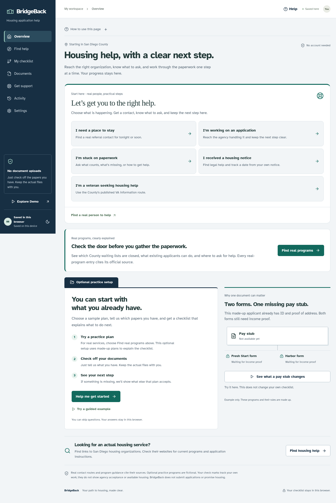

# BridgeBack · A way forward

**Your Path to Housing, Made Clear.** A private housing-preparation PWA that makes application dependencies visible, explains the next useful action, and finds accepted alternatives when a document is out of reach.

[Open BridgeBack](https://bridge-back-one.vercel.app/) · [Public deployment checks](https://github.com/prestonbliang/BridgeBack/actions/workflows/deployment-check.yml)

The [current hosted verification](https://github.com/prestonbliang/BridgeBack/actions/runs/40033238226) passed the HTTP checks and all 28 desktop/mobile/offline browser cases against this public address, with no skipped cases or source-review warnings. [Recorded evidence](docs/public-deployment-evidence.json) identifies the exact published revision, report artifact and practical limits.

BridgeBack combines a reviewed real-program guidance layer with a separate fictional demonstration of its dependency engine. Profiles stay local; a small read-only web endpoint checks public source pages. No account, document uploads or AI service is required.

## Start with the situation, leave with a next step

The first screen now gets someone to a real contact for housing help, an existing application, missing paperwork, a notice or a veteran referral. City and County cases get different contacts. Each plan includes a call script, questions to ask, help with calling/portal barriers, reported contact outcomes, confirmed next instructions and personal follow-up dates.

An unanswered message stays unanswered. A referral needs a usable handoff. Paperwork categories are added only after the person confirms the provider's instructions; preparation never means acceptance. Saved plans and contact sheets work offline. **Help me with this step** connects real-program checklists to the right contact workflow. See [the contact-to-follow-up design and a 90-second demo](docs/CONTACT-WORKFLOW.md).

## Real-program production candidate

Find help now includes **County Section 8, County Public Housing and HUD-VASH referral guidance**, reviewed against eleven official sources on October 23, 2026. Save a real follow-up plan and choose new-inquiry or existing-waiting-list guidance. Track actual personal steps, use online **or** assisted access, correct mistakes and export the plan. The Public Housing working-preference inventory uses the actual policy's recent-pay-stubs **OR** employer-statement rule; it is separate from fictional document acceptance.

**Both County waiting lists are closed to new applicants in the reviewed application directions.** The app explains contradictory application, income and residency wording across official sources and asks for agency confirmation. It never turns a residency preference into an automatic denial. Real screening is a partial comparison, not a complete eligibility determination.

In the hosted web app, **Check official pages** loads a dated, shared source check (up to 15-minute refresh). Changed wording/PDFs are flagged for human review. Offline and installed iOS use reviewed saved guidance; no live vouchers, units or appointments are claimed. Daily source-audit CI and production browser/container checks support maintenance. See [production scope, deployment and release gates](docs/PRODUCTION-READINESS.md), including screenshots from the running container.

## What changed in the interface

BridgeBack now uses plain page names: **Find help**, **My checklist**, **Documents**, and **Activity**. The overview explains how to start and includes an interactive pay-stub example that does not change personal progress. Each page has “How to use this page,” and **Help** explains common terms with concrete examples.

The design uses a navy navigation rail, a document-folder layout for the main task, and locally hosted Atkinson Hyperlegible fonts. The checklist comes before optional planning tools. Document descriptions explain what the paper is, what counts in each example plan and what checking a box means. See the [design rationale and public skills consulted](docs/DESIGN.md).



[Phone contact plan](docs/screenshots/help-desk-phone.png) · [Dark theme](docs/screenshots/help-desk-dark.png)

## Try the signature experience

Start the app and choose **Explore Demo** or **Try a guided example**. A seven-scene guide introduces PathFinder, BarrierBreak, a real what-if simulation, actual progress, shared documents and a printable/exportable action plan. The fictional demo is temporary and does not overwrite personal progress.

- **PathFinder:** connected program-specific requirements, interactive unified graph, focused routes, accessible checklist, dynamic readiness and immediate unlock announcements.
- **BarrierBreak:** ranks currently unresolved obstacles by blocked downstream requirements and distinguishes them from actual immediate unlocks.
- **What-if:** calculates before/after readiness, newly available steps, remaining barriers and the next recommendation without changing saved state. Explicitly apply the step when ready.
- **Explainability:** structured facts, missing information, assumptions, source provenance and change conditions from the rules engine.
- **Document reuse:** one inventory updates all explicitly accepting programs. A document accepted by one plan does not automatically count for another.
- **Route Rescue:** finds the smallest feasible set of additional accepted document types when some documents are unavailable. Reports impossible requirements honestly.
- **Adaptive onboarding:** optional, resumable questions, a geographic branch that skips irrelevant local questions, and immediate next steps.
- **Timeline:** timestamped real events with guarded corrections, including completion, program selection, newly available work and exports.
- **Local-first PWA:** validated IndexedDB storage, versioned migration, cross-tab conflict/deletion protection, safe storage failure handling, offline shell and computations, export/deletion, light/dark themes and larger text.

## If someone gets stuck

Open **Get support**, or choose the help button beside a checklist item. General housing questions, real contacts and follow-up plans work without adding a fictional program. The app can break a confusing step into smaller ones, explain the exact alternatives, teach common paperwork concepts, and help prepare questions for a real organization.

- Help-plan progress, calls and waiting for replies stay separate from application readiness.
- Guided completion requires a correct understanding check, reviewed help steps, explicit readiness confirmation and a fresh dependency check.
- **Talk to someone** includes dated public counselor data from the CFPB’s HUD-powered finder, with rental-service, language and distance filters. The current snapshot has ten listings for a 92101 search; four list rental counseling within 25 miles of that search point.
- Choose a public contact, download questions, record a broad outcome and set a personal follow-up reminder. Open questions appear on Overview.
- **Learn the paperwork** offers a fictional pay-stub exercise and an income-period helper. Neither changes the profile automatically.

[Guided support](docs/screenshots/support-desktop.png) · [Phone view](docs/screenshots/support-mobile.png) · [Official-source counselor directory](docs/screenshots/counselor-directory.png)

See [support behavior, external sources and maintenance](docs/SUPPORT.md). Counselor listings are real public data; preparation plans remain fictional. A listing is not an available appointment or housing offer.

## iOS beta handoff

The repository includes a Capacitor 8 iPhone/iPad project targeting iOS 16+. It bundles the interface, fonts, dated resources, privacy page and calculations for first-launch offline use. Native exports use the system share sheet, clean up temporary files, and distinguish cancellation from success. Safe-area layouts and a native app-switcher privacy cover are included.

On a Mac with Node 22+, Python 3 and Xcode 26+:

```sh
npm ci
npm run ios:bundle
npm run ios:check
npm run ios:open
```

The [iOS handoff](docs/IOS.md) explains signing, simulator/device checks and TestFlight gates. [Submission copy](docs/IOS-SUBMISSION.md) is prepared for publisher review. The macOS CI workflow has successfully compiled both unsigned simulator and device apps; see [recorded build evidence](docs/ios-build-evidence.json). Actual-device runtime testing, signing and Apple submission remain publisher steps. The bundle identifier is provisional. This is not an App Store certification.

Overview now opens real San Diego counselor support directly, without a practice plan or income profile. The [Scott Peters/district presentation brief](docs/DISTRICT-BRIEF.md) emphasizes local usefulness, original programming, honest evidence and privacy. It makes no claim about an endorsement or his personal preferences.

## Run locally

Use Node 22 or 24 and npm (validated here with Node 24).

```sh
npm ci
npm run dev
```

For a production demonstration and offline caching:

```sh
npm run build
npm start
```

The postbuild step generates `public/sw.js` from `service-worker/worker.js`, stamped with the completed build ID. It is generated output and should not be edited. Service-worker registration is production-only. When developing after a production run, unregister the old worker in browser tools to avoid a cached production shell. After rebuilding a production version, close all old BridgeBack tabs and reopen the app so a waiting update can activate. Your IndexedDB checklist stays separate from cached app files.

## Validate

```sh
npm run test
npm run evaluate
npm run lint
npm run build
npm run typecheck
npm run test:e2e
```

E2E requires a completed production build and free port 3000; the runner owns its server. It uses `/usr/bin/chromium` if installed, otherwise Playwright Chromium. Elsewhere run `npx playwright install chromium` and install required system libraries, or set `PLAYWRIGHT_CHROMIUM_EXECUTABLE` to your Chromium binary.

For the bundled iOS web interface, run `npm run ios:bundle`, `npm run ios:check`, then `npm run test:ios-web`. These browser checks disable networking and simulate the native bridge; they do not run UIKit or WKWebView. Rebuild the regular web target with `npm run build` before using `npm start` or the normal E2E suite after a native export.

The fictional evaluation fixtures assert expected blocker counts, recommendations, exact AND/OR behavior, reuse acceptance/rejection, screening boundaries, readiness changes, simulation parity and alternative-route feasibility. These are correctness measurements, not real-world impact statistics. See [validation evidence](docs/VALIDATION.md).

The checked-in [benchmark results](docs/evaluation-results.json) record 22 passing independently specified cases. In its two-program missing-income fixture, a shared pay stub affects eight blocked downstream requirements, makes exactly two forms actionable and advances readiness by 20 percentage points. These values describe that fixture, not promised outcomes for real applicants.

## Accuracy and privacy

**The three practice programs remain fictional and separate from the three real-program entries.** Real entries cite reviewed official sources, show closures/conflicts and provide limited criteria comparisons and personal follow-up plans. Counselor data is a dated public snapshot. The contact workflow separately cites five reviewed contact excerpts, including SDHC's specific contact page and Legal Aid's published number. 211's homepage remains unreviewed; its phone-referral route was checked against County guidance. No live appointments, housing availability, verified agency deadline or complete eligibility screening is asserted. No government application is submitted and no eligibility, acceptance or housing is guaranteed.

Only document status is stored. Do not enter names, Social Security numbers or document contents. Browser storage is not encrypted secure storage. Export before clearing site data if you want a copy. See [privacy details](docs/PRIVACY.md).

## Deploy

The production address is **https://bridge-back-one.vercel.app/**. The [Vercel walkthrough](docs/PUBLIC-DEPLOYMENT.md) explains GitHub access, exact import settings, public-access protection, installation, updates and rollback. The repository includes `vercel.json` and a **Check a public deployment** Actions workflow that runs HTTP checks and the desktop/mobile/offline regression suite against that HTTPS address. Review the actual workflow result before treating a release as verified.

Deploy to an HTTPS Next.js-compatible host such as Vercel or any Node server. Build: `npm ci && npm run build`. Start: `npm start`. No secrets, database or API configuration are needed. The counselor directory and reviewed rules use checked-in snapshots. The web source-status route performs bounded public-page checks during prerender/revalidation; fetch failures return explicit unavailable results and do not fail the application build. The native export generates a bundled marker and makes no source-check requests. Maintainers can refresh it with `npm run sources:counselors` and then rebuild; failed imports retain the prior snapshot. Serve at the origin root. HTTPS is required for installation outside local development. Keep `/sw.js` revalidated by the host; its build ID changes automatically after every production build. Worker updates wait for older tabs to close so the HTML/assets remain paired.

Android: browser menu → Install app. iPhone: Safari → Share → Add to Home Screen. Visit online and wait for **Offline ready** before relying on offline operation. External provider links require a connection. Actual iPhone/Android installation and screen-reader review remain distinct manual checks; Chromium emulation is not a device certification.

## Technical documentation

- [Critical audit and priorities](docs/PHASE2-AUDIT.md)
- [Architecture and algorithms](docs/ARCHITECTURE.md)
- [Original feature selection: Route Rescue](docs/FEATURE-SELECTION.md)
- [Two-minute competition script](docs/DEMO.md)
- [Privacy and data lifecycle](docs/PRIVACY.md)
- [Validation and release limits](docs/VALIDATION.md)
- [iOS/TestFlight handoff](docs/IOS.md)
- [App Store copy and reviewer notes](docs/IOS-SUBMISSION.md)
- [District presentation brief](docs/DISTRICT-BRIEF.md)

## Competition review packet

[Watch the two-minute captioned review recording](docs/media/BridgeBack-review.mp4), with [captions](docs/media/BridgeBack-review.srt) and a [timed narration draft](docs/DEMO-NARRATION.md). It is silent review footage; add actual participant identification and your own narration before publishing.

Start with the [2026 submission guide](docs/SUBMISSION.md), [code walkthrough](docs/CODE-WALKTHROUGH.md) and [development/AI-assistance record](docs/DEVELOPMENT-PROCESS.md). The entrant reports reviewing and understanding the code; the record distinguishes this from personal implementation claims. The guide documents conflicting official deadline wording: prepare before **October 26, 2026, 8 a.m. Pacific**, the earliest published time. Confirm with the organizer.

`npm run notices:check` verifies the lockfile-matched open-source inventory; Settings opens full acknowledgments, including offline. After committing changes and recording a successful matching CI run with `npm run ci:evidence -- RUN_ID`, run `npm run submission:pack` for a source ZIP and SHA-256 review manifest. Packaging refuses uncommitted changes or application source that differs from the native-tested commit.

With a production server running, system FFmpeg installed and the Playwright recording binary available (`npx playwright install ffmpeg`), `npm run demo:record` records two minutes of real browser interactions and creates a captioned review MP4/SRT in `artifacts/`. This silent review footage still needs participant identification, your own accurate narration and full assistance disclosure before the required public video submission. It does not upload or submit anything.

The [production readiness record](docs/PRODUCTION-READINESS.md) explains Docker deployment, source-change review and schema-4 migration. `npm run programs:audit` checks program sources and published contact excerpts; ordinary unit/E2E tests remain deterministic.
