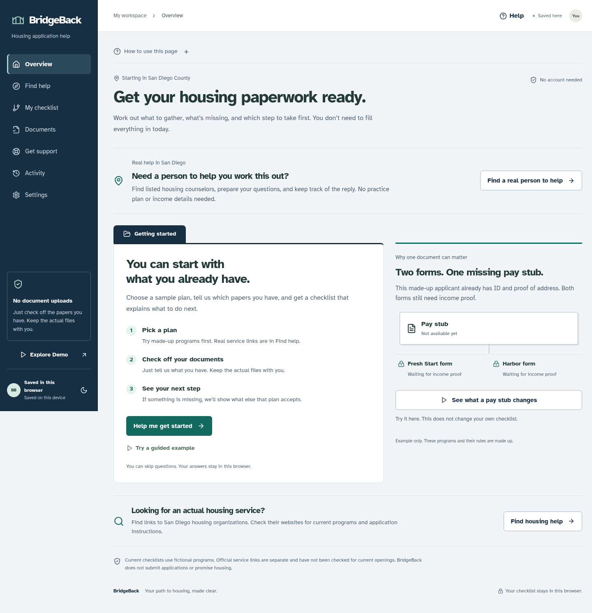

# BridgeBack · A way forward

**Your Path to Housing, Made Clear.** A private housing-preparation PWA that makes application dependencies visible, explains the next useful action, and finds accepted alternatives when a document is out of reach.

Phase 2 evolves the original Next.js/TypeScript, Dexie and graph-engine foundation. It adds meaningful planning capabilities without a backend, account, uploads or AI service.

## What changed in the interface

BridgeBack now uses plain page names: **Find help**, **My checklist**, **Documents**, and **Activity**. The overview explains how to start and includes an interactive pay-stub example that does not change personal progress. Each page has “How to use this page,” and **Help** explains common terms with concrete examples.

The design uses a navy navigation rail, a document-folder layout for the main task, and locally hosted Atkinson Hyperlegible fonts. The checklist comes before optional planning tools. Document descriptions explain what the paper is, what counts in each example plan and what checking a box means. See the [design rationale and public skills consulted](docs/DESIGN.md).



[Phone layout](docs/screenshots/overview-mobile.png) · [Dark theme](docs/screenshots/overview-dark.png)

## Try the signature experience

Start the app and choose **Explore Demo** or **Try a guided example**. A seven-scene guide introduces PathFinder, BarrierBreak, a real what-if simulation, actual progress, shared documents and a printable/exportable action plan. The fictional demo is temporary and does not overwrite personal progress.

- **PathFinder:** connected program-specific requirements, interactive unified graph, focused routes, accessible checklist, dynamic readiness and immediate unlock announcements.
- **BarrierBreak:** ranks currently unresolved obstacles by blocked downstream requirements and distinguishes them from actual immediate unlocks.
- **What-if:** calculates before/after readiness, newly available steps, remaining barriers and the next recommendation without changing saved state. Explicitly apply the step when ready.
- **Explainability:** structured facts, missing information, assumptions, source provenance and change conditions from the rules engine.
- **Document reuse:** one inventory updates all explicitly accepting programs. A document accepted by one plan does not automatically count for another.
- **Route Rescue:** finds the smallest feasible set of additional accepted document types when some documents are unavailable. Reports impossible requirements honestly.
- **Adaptive onboarding:** optional, resumable questions, a geographic branch that skips irrelevant local questions, and immediate next steps.
- **Timeline:** timestamped real events with guarded corrections, including completion, program selection, newly available work and exports.
- **Local-first PWA:** validated IndexedDB storage, versioned migration, cross-tab conflict/deletion protection, safe storage failure handling, offline shell and computations, export/deletion, light/dark themes and larger text.

## If someone gets stuck

Open **Get support**, or choose the help button beside a checklist item. General housing questions, real contacts and follow-up plans work without adding a fictional program. The app can break a confusing step into smaller ones, explain the exact alternatives, teach common paperwork concepts, and help prepare questions for a real organization.

- Help-plan progress, calls and waiting for replies stay separate from application readiness.
- Guided completion requires a correct understanding check, reviewed help steps, explicit readiness confirmation and a fresh dependency check.
- **Talk to someone** includes dated public counselor data from the CFPB’s HUD-powered finder, with rental-service, language and distance filters. The current snapshot has ten listings for a 92101 search; four list rental counseling within 25 miles of that search point.
- Choose a public contact, download questions, record a broad outcome and set a personal follow-up reminder. Open questions appear on Overview.
- **Learn the paperwork** offers a fictional pay-stub exercise and an income-period helper. Neither changes the profile automatically.

[Guided support](docs/screenshots/support-desktop.png) · [Phone view](docs/screenshots/support-mobile.png) · [Official-source counselor directory](docs/screenshots/counselor-directory.png)

See [support behavior, external sources and maintenance](docs/SUPPORT.md). Counselor listings are real public data; preparation plans remain fictional. A listing is not an available appointment or housing offer.

## Run locally

Use Node 22 or 24 and npm (validated here with Node 24).

```sh
npm ci
npm run dev
```

For a production demonstration and offline caching:

```sh
npm run build
npm start
```

The postbuild step generates `public/sw.js` from `service-worker/worker.js`, stamped with the completed build ID. It is generated output and should not be edited. Service-worker registration is production-only. When developing after a production run, unregister the old worker in browser tools to avoid a cached production shell. After rebuilding a production version, close all old BridgeBack tabs and reopen the app so a waiting update can activate. Your IndexedDB checklist stays separate from cached app files.

## Validate

```sh
npm run test
npm run evaluate
npm run lint
npm run build
npm run typecheck
npm run test:e2e
```

E2E requires a completed production build and free port 3000; the runner owns its server. It uses `/usr/bin/chromium` if installed, otherwise Playwright Chromium. Elsewhere run `npx playwright install chromium` and install required system libraries, or set `PLAYWRIGHT_CHROMIUM_EXECUTABLE` to your Chromium binary.

The fictional evaluation fixtures assert expected blocker counts, recommendations, exact AND/OR behavior, reuse acceptance/rejection, screening boundaries, readiness changes, simulation parity and alternative-route feasibility. These are correctness measurements, not real-world impact statistics. See [validation evidence](docs/VALIDATION.md).

The checked-in [benchmark results](docs/evaluation-results.json) record 22 passing independently specified cases. In its two-program missing-income fixture, a shared pay stub affects eight blocked downstream requirements, makes exactly two forms actionable and advances readiness by 20 percentage points. These values describe that fixture, not promised outcomes for real applicants.

## Accuracy and privacy

**All three preparation programs and their criteria are explicitly fictional.** Real counselor/contact data and reviewed guidance sources are separated from fictional preparation rules. Each source shows its own review or retrieval date; two referral homepages remain unreviewed after access-denied responses. No live appointments, housing availability or agency deadline is asserted. Real program screening still requires reviewed program-specific rules. No government application is submitted and no eligibility, acceptance or housing is guaranteed.

Only document status is stored. Do not enter names, Social Security numbers or document contents. Browser storage is not encrypted secure storage. Export before clearing site data if you want a copy. See [privacy details](docs/PRIVACY.md).

## Deploy

Deploy to an HTTPS Next.js-compatible host such as Vercel or any Node server. Build: `npm ci && npm run build`. Start: `npm start`. No secrets, database or API configuration are needed. Builds use the checked-in counselor snapshot without an external request. Maintainers can refresh it with `npm run sources:counselors` and then rebuild; failed imports retain the prior snapshot. Serve at the origin root. HTTPS is required for installation outside local development. Keep `/sw.js` revalidated by the host; its build ID changes automatically after every production build. Worker updates wait for older tabs to close so the HTML/assets remain paired.

Android: browser menu → Install app. iPhone: Safari → Share → Add to Home Screen. Visit online and wait for **Offline ready** before relying on offline operation. External provider links require a connection. Actual iPhone/Android installation and screen-reader review remain distinct manual checks; Chromium emulation is not a device certification.

## Technical documentation

- [Critical audit and priorities](docs/PHASE2-AUDIT.md)
- [Architecture and algorithms](docs/ARCHITECTURE.md)
- [Original feature selection: Route Rescue](docs/FEATURE-SELECTION.md)
- [Two-minute competition script](docs/DEMO.md)
- [Privacy and data lifecycle](docs/PRIVACY.md)
- [Validation and release limits](docs/VALIDATION.md)
