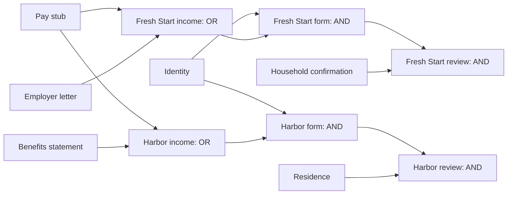

# Explain the engineering, with the code open

This guide helps an entrant or reviewer trace observable behavior to the implementation. It is not proof that someone wrote or understands the code. The entrant should be able to run the checks, explain the tradeoffs and answer follow-up questions in their own words.

## Follow one missing document

Start in `lib/programs.ts`. Fresh Start accepts pay stub **or** employer letter. Harbor accepts pay stub **or** benefits statement. These are explicitly fictional rules. Identity is required for both forms; residence and household confirmation affect their separate review steps.

1. `compile` in `lib/planner.ts` creates canonical `doc:*` nodes and program-scoped acceptance gates/tasks. The same document has one inventory status; acceptance remains program-specific.
2. `topologicalSort` in `lib/engine.ts` rejects cycles, duplicate IDs and unknown prerequisites. A three-state DFS orders prerequisites before consumers in O(V+E) for a valid graph. “Visiting” and “done” are different; confusing them would miss cycles or falsely report them.
3. `evaluateStatuses` resolves every node in order. All `all` prerequisites and at least one `any` alternative must be satisfied. A recorded task completion cannot override missing prerequisites. Unavailable documents cannot satisfy a gate.
4. `evaluatePlan` counts the program’s explicit milestones. Optional alternative papers do not add denominator entries. Two programs’ income milestones can become satisfied through one shared document; that is distinct from counting the paper twice.
5. Each available action is evaluated with a copied hypothetical input. Status differences identify tasks that become actionable immediately. A graph descendant count is also shown, but it is not called an immediate unlock.
6. The actual document action goes through `updateWorkspace`, recalculates derived results and adds a real event. What-if evaluation never calls that reducer.

Run `npm run evaluate`. In its missing-income fixture, readiness goes from 30% to 50% and two forms become available. The untouched UI demo has residence available too, so its corresponding result is 40% to 60%. Explain the different starting states rather than memorizing a percentage.

## Explain the ranking without mystique

In `evaluatePlan`, progress points combine immediate available steps, additionally satisfied requirements and connected unfinished items. The selected priority changes the weight given to progress and reported effort. A verified upcoming deadline and preferred program can add points. Ties use stable IDs.

These weights are transparent product heuristics, not scientifically validated predictions of approval or applicant success. Why use a simulated status difference? Because a node can have many descendants that remain blocked by other prerequisites. Show a counterexample and explain what would change if you weighted effort more strongly.

## Explain an impossible route

`findRescueRoute` treats each program-specific acceptance list as a coverage requirement, removes already-satisfied groups, excludes unavailable documents, and looks for the smallest remaining accepted set. Effort breaks equal-size ties; lexical order makes the result deterministic.

The shipped catalog has five document types, so at most 32 subsets are examined. The implementation rejects catalogs with more than 16 candidates; exact enumeration is exponential, not a general large-scale optimizer. A future large catalog would need a different search strategy or approximation with clearly stated limits. A mandatory identity gate with every option unavailable must return “no accepted route,” not an invented exception.

## Explain how mistakes and data loss are handled

- `lib/workspace.ts` validates saved state and every typed action. A guided help finish rechecks reviews, understanding, explicit confirmation and current actionability in the reducer; a disabled button alone is insufficient protection.
- `lib/store.ts` serializes saves and checks transaction revisions. A stale tab cannot overwrite a newer change or resurrect a deleted profile. An unreadable record is preserved instead of being silently replaced with blank data.
- The demo is a separate in-memory workspace. Preview and learning exercises do not mutate personal progress.
- The service worker installs the shell, privacy page and matching static assets as a complete candidate before changing the active pointer. Failed updates preserve the previous complete cache and unrelated applications’ caches.
- Native exports use app cache plus the OS share sheet. Completion, cancellation, failure and interrupted cleanup have different outcomes. Slow startup cleanup finishes before a new file is written. Bridge logging is disabled.

## Defend the scope and the tradeoffs

| Choice                                    | Reason                                                                              | Cost or limit                                                                                                 |
| ----------------------------------------- | ----------------------------------------------------------------------------------- | ------------------------------------------------------------------------------------------------------------- |
| Deterministic rules instead of runtime AI | Every screening/recommendation has inspectable inputs and causes                    | Accurate real screening still needs reviewed program-specific rules                                           |
| Local-first IndexedDB                     | No account/backend or document uploads; offline computation                         | No cross-device sync, guaranteed backup or encryption claim                                                   |
| Explicit milestones and AND/OR gates      | Alternatives satisfy requirements without inflating progress                        | Catalog modeling needs careful review; a bad published rule is not fixed by a correct algorithm               |
| Dated public counselor snapshot           | Useful offline, no profile transmission to a third-party API                        | Limited geography/results; services and appointments must be confirmed                                        |
| Native bundled web target                 | Reuse tested logic and add offline first launch, sharing and app lifecycle behavior | UIKit/WKWebView and VoiceOver still require real-device tests; compilation does not establish review approval |

## Questions to answer live

What breaks if an OR list is treated as AND? Why does an employer letter not satisfy Harbor? Why is 100% readiness not approval? What if a form was checked complete before its evidence disappeared? What survives a failed storage read? What is the difference between a blocked descendant and an immediate unlock? Which claims remain unverified? Which parts did **you** personally implement, and how was AI involved?

Answers should follow the actual code and evidence. See [development process](DEVELOPMENT-PROCESS.md) for the authorship requirements and [validation](VALIDATION.md) for what was actually executed.

## Follow the real-program boundary

Inspect `official-catalog.json`, `official-screening.ts` and `official-plans.ts`. Explain why the 50%-AMI overview cannot disqualify someone when the linked admissions policy describes 80% and uses residency preferences. The actual table has separate household rows; limits are not a guessed linear increment. Missing/contradictory factors remain uncertain.

The real follow-up graph shares an OR access milestone between the online and assisted routes. Letters can be reviewed without arranging portal access. Correcting access clears dependent contact/follow-up checks while preserving the independent letter review. The separately tracked pay-stubs OR employer-statement option is explicitly working-preference evidence, not general program admission.

Trace the source checker’s allowlist, redirect/size/timeout guards, text/PDF comparison and ISR timestamps. A quote still present is narrower evidence than “all rules verified.” Native export produces an offline marker, not a fake current check. Explain how a stale or unavailable result is handled before demonstrating it.
